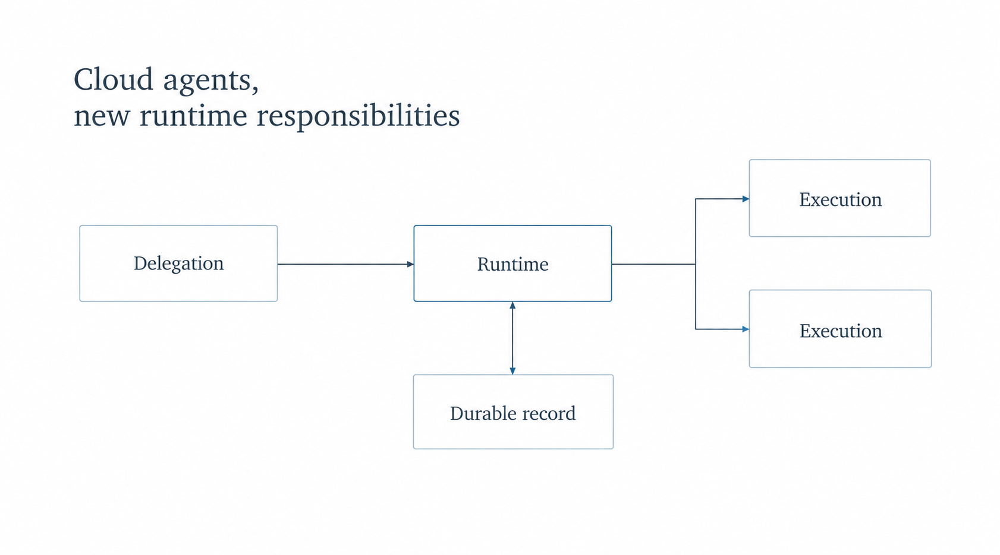
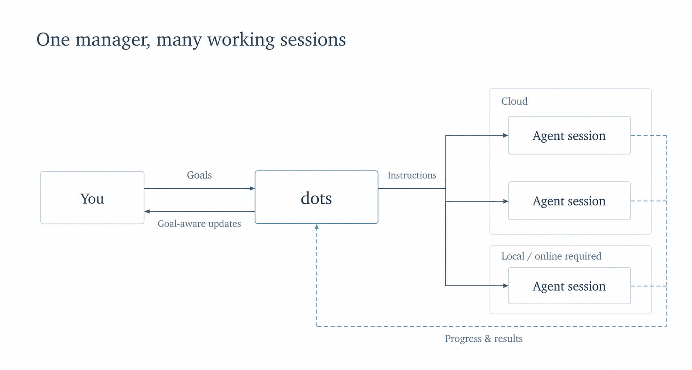
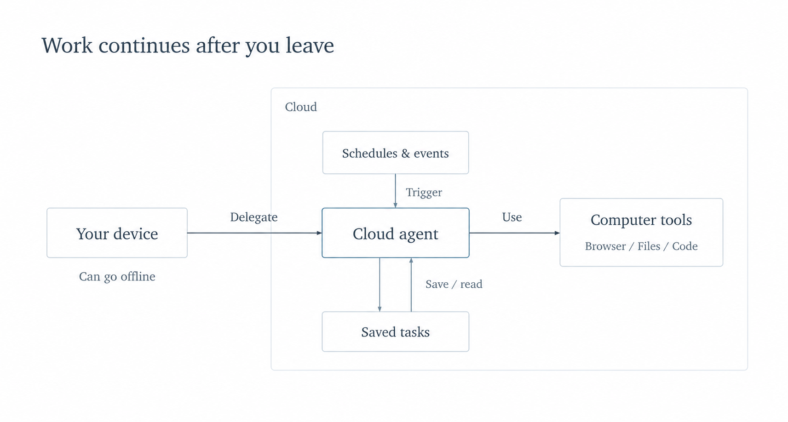
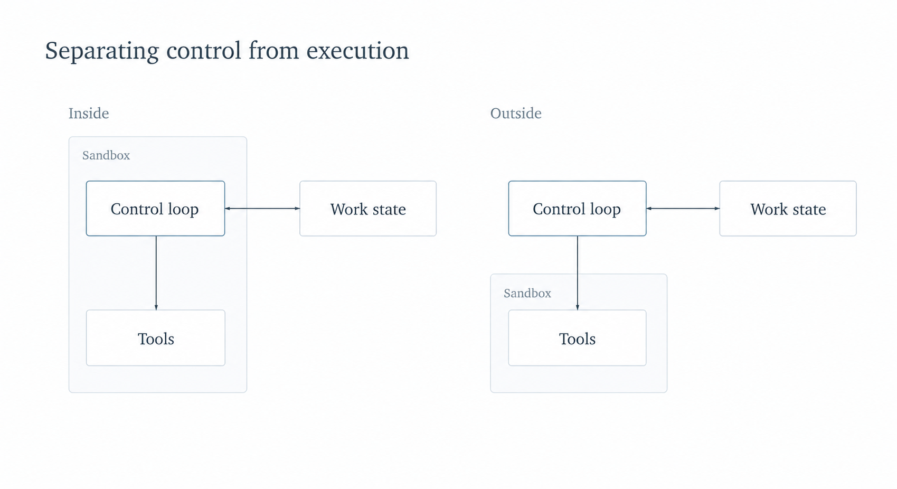
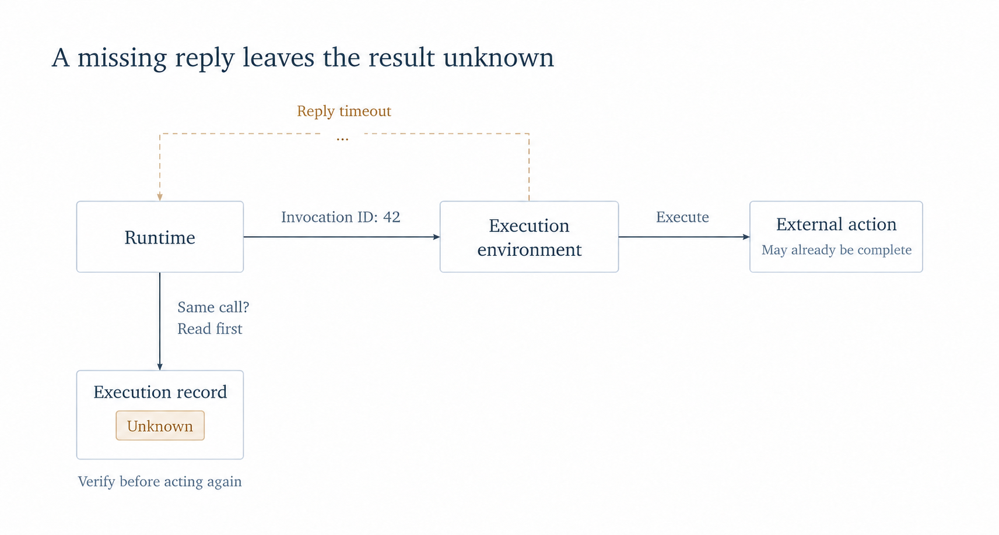
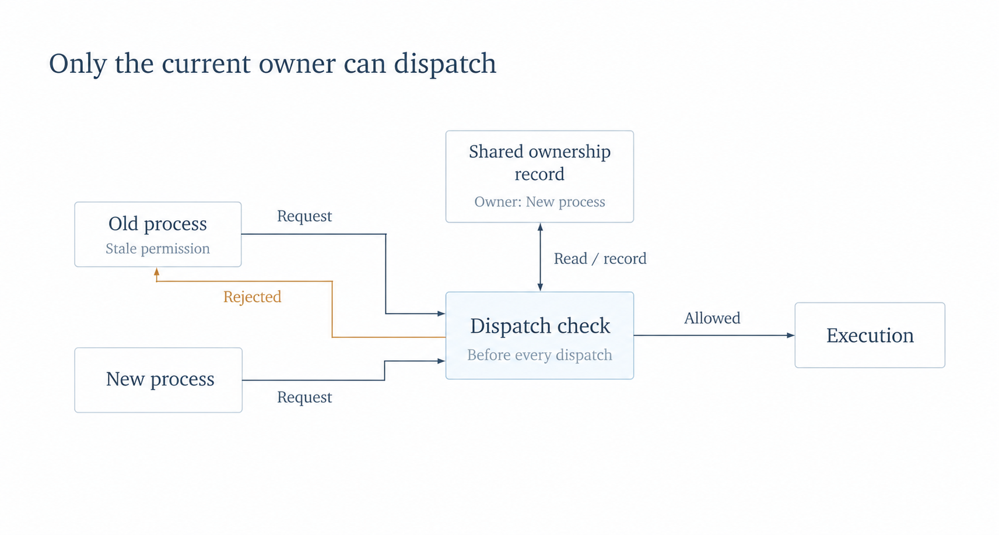

# 云端 agent 与 runtime 的新职责

> 配套演示影片：[《Silence：云端 Agent 静默故障与外部 Loop 恢复》（3m28s, 1080p）](https://github.com/Bai-009/ai-product-research/releases/download/videos-v1/02-CloudAgent-Silence-Film-1080p.mp4) ｜ [《Astra：Context-to-Execution Runtime 概念影片》（1m27s, 4K）](https://github.com/Bai-009/ai-product-research/releases/download/videos-v1/01-Astra-Context-Runtime-Film-4K.mp4)

九月以来，几家头部 AI 公司推出的新品中，云端 agent 格外引人注目。Meta 的 Muse、xAI 的 Grok Bot、OpenAI 的 dots，正在把 personal agent 变成可以交付给用户的服务。另一边，面向开发者，Anthropic 也拿出了专门的体验额度，鼓励 Claude Code 用户尝试云端会话。从日常事务到开发工作，厂商们都在邀请用户交出更多事情，让 agent 在用户离开电脑后继续工作。

模型原本就在云端，但使用本地 agent 时，打开浏览器、读写文件、运行代码，仍常常要在用户自己的电脑上完成。如今，agent 可以在云端完成这些操作。用户合上电脑，任务仍能继续。这让一个朴素的愿望有了实现的机会：交代过的事情，在自己离开以后，仍然可以继续处理。几家公司从不同的使用场景出发，走向了相近的方向。理解它们各自回应的问题，也就能看清这轮云端 agent 热潮的来由。

## 一、任务并行以后，人的注意力成了瓶颈

随着模型处理长任务的能力增强，使用 Codex 这样的编程 agent 时，人们也越来越愿意把一份完整的工作交给它。从理解需求、修改代码，到运行测试、根据结果继续修改，模型在组织上下文、调用工具和推进执行的 harness 支持下，可以自行完成许多步骤。这份工作可能持续一个多小时，甚至几天。运行代码、测试和实验，可以占去长任务的大部分时间，远超过模型本身的推理。用户却不必全程参与，原先需要亲手操作的时间，有一部分变成了等待。

等待的时候，自然会想做点别的事情。既然一个 agent 已经在处理手头的任务，再开一个会话，让另一个 agent 推进另一件事，是很自然的安排。于是，一个会话变成两个、三个，几项工作开始同时进行。但每次切换，用户都得重新回忆：这一项原来要解决什么问题，上次讨论到哪里，眼前的结果又意味着什么。刚接上这边的思路，另一边可能又有新的问题需要回答。会话虽不是很多，但这样的切换就足以让人难以专注。

等到任务结束，读懂汇报、判断结果，还要花一番心力。执行 agent 经历了查找、尝试、失败和修改，用户却没有跟着走过这些过程。它汇报时认为无需解释的前提，对用户可能恰恰是陌生的。一份报告即使列出了修改和测试结果，用户仍要弄清楚：这些变化与最初的要求有什么关系，究竟完成了什么，还有哪些事情没有解决。几项长任务陆续结束，理解和判断结果的负担，又回到了用户面前。

九月底在 OpenAI DevDay 上亮相的云端助手 dots，尝试站在用户与执行会话之间，做一个持续跟进工作的管理者。用户可以向它交代目标，由它分派任务、查看进展，并向执行 agent 发出后续指令。结果返回以后，它再结合用户最初的问题组织汇报：哪些结果值得关注，哪些地方需要追问，哪些决定仍要由用户来做。把报告写得通俗只是其中一步，更重要的是，它需要把执行过程中形成的细节，重新放回用户关心的问题中去。

有了这一层，用户可以通过 dots 掌握几项工作的进展，少了来回切换会话、反复回忆任务背景的负担。dots 既可以协调云端任务，也可以协调连接在本地电脑上的任务。它在云端运行，这层管理便可以延续到用户离开电脑以后。用户关闭电脑，本地任务依旧会随之停止；但云端任务会继续运行，由 dots 接收结果、跟进后续，再向用户汇报。**更多工作可以同时推进，而逐项跟进的负担不必全部落在人身上**。这正是 dots 对规模化使用 agent 的一种尝试。

*图 1｜dots 站在用户与执行会话之间，分派工作、跟进结果，再围绕用户的目标汇报。本地会话仍需设备在线。*

## 二、日常事务如何交给 personal agent

对于已经同时使用几个 agent 的人，怎样管理这些工作是一个迫切的问题。对更多普通用户而言，需求要朴素一些：让 AI 替自己办成一件事。他们未必经常使用电脑，却也需要整理资料、处理账单、安排出行。电脑里有不少工具能派上用场，只是要用好它们，往往得先花工夫学习。人们想解决的是眼前的问题，未必愿意为此专门学一门技术。

Muse 从这些日常需要入手。它可以留意邮件里的重要消息、安排日程，也可以使用浏览器、读写文件，必要时编写代码、制作工具。让 AI 生成一段程序，如今已经很常见；但程序写出来以后，怎样运行、从哪里取得资料、怎样把结果用起来，仍可能需要用户操心。Muse 配备了一台云端电脑，让 agent 有地方完成这些操作。用户从手机交代需求，它便可以选择工具、执行步骤，再把结果带回来。用户也不必为了完成这些操作，自己准备并持续维护一套电脑环境。

专业的计算机能力向普通用户开放，正可以发生在这样的过程中。过去，用户往往要先知道该用什么软件、怎样操作，才能判断一件事做不做得成。现在，可以先把需求说出来，让 agent 寻找合适的工具和方法。它替人省下了操作的工夫，也让过去因技术门槛而难以完成的事情，进入普通用户力所能及的范围。

而要持续替人处理日常事务，personal agent 还得记住那些今天交代、以后才要办的事情。今天说“明天上午帮我订一张机票”，工作就要等到明天。这项任务也许只需几分钟，系统却得记住今天的交代，并在约定的时间开始处理。如果依赖本地电脑上的程序，届时电脑关机或休眠，这件事便无从开始。云端 agent 可以保存委托，到时查询航班、整理选择，需要确认行程或付款时，再通知用户。模型不必整夜运行，但到了明天，今天交代的事情仍然要有人接着办。

xAI 的 Grok Bot 所强调的固定角色与职责，又把这种委托延伸了一步。用户可以让一个 Bot 长期负责某类工作，保留相关背景，将熟悉的流程按日程重复执行。订一张机票，办完便告一段落；一项长期职责，却不会随着单次任务的完成而结束。它需要记得此前的安排，等到新的消息到来，或下一个约定的时间，再继续处理。

*图 2｜委托先被保存，再由日程或事件触发。用户离开以后，云端仍可以使用电脑工具继续处理。*

## 三、云端运行的两层连续性

这些安排不能随着用户关机而中断。云端首先提供了**第一层连续性：用户可以离开，已经交代的事情仍能得到处理。**

Muse 将负责调用模型、推进任务的核心 harness，与浏览器、文件和命令行工具放在同一个隔离容器中。这种安排通常称为 agent in the sandbox；它的应用状态则另作持久保存。用户关掉自己的设备，agent 仍有一套完整的云端环境可用，可以继续处理事务，或等待下一次任务开始。

不过，一项长期职责可能延续几个月，承接它的运行环境却难免需要维护、重启，也可能发生故障。沙箱停止时，里面负责推进任务的程序也会一起停止。文件即使还在，也得先恢复程序，再找回进度，才能知道哪些事情需要接着做。用户关机已不再妨碍工作，但任务能否持续进行，仍取决于云端沙箱是否正常运作。

同时，工作增加以后，同一套环境也会逐渐接近容量上限。一个任务正在浏览网页，另一个开始运行代码，都要占用处理器和内存。前面 dots 让人看到了驾驭更多 agent 的可能，但管理得过来，并不意味着一台电脑也执行得过来。可以增加更多沙箱，让各自的 agent 分担任务；在这种成套部署的方式下，控制程序与工具环境也随之一起增加。如何分配工作、准备文件和工具，仍然需要运行系统安排。

要跨过一次执行环境的中断，系统需要保存目标和进度，并安排程序怎样恢复工作。控制与工具执行放在同一个沙箱里，可以通过保存状态、重建环境来接续；将两者分开，则让控制程序不必随每个执行环境一起重启或扩容。agent outside the sandbox 采用的正是后一种分工：将调用模型、推进任务的程序放在沙箱之外；浏览器操作、代码运行等具体工作，则交给相应的执行环境。

前面 dots 所展示的协调与执行分工，可以帮助理解这种关系：用户向它交代目标，它向执行会话分派工作，再根据结果继续跟进。运行系统内部也可以如此，由控制程序持续掌握任务，将具体操作交给合适的环境。需要更多计算能力时，可以增加执行资源，而不必把整套控制程序一同搬过去。

采用这种分工，控制程序仍需要将任务的目标和进度持久保存在执行环境之外。某个沙箱停止以后，它才有依据查明此前做到哪里，再安排新的执行环境。待文件、工具和恢复所需的条件就绪，后续程序便能按确认过的进度继续处理。**第二层连续性要求的正是这一点：同一份委托能够跨过执行环境的中断。**它依靠状态保存与恢复机制；控制与执行的分离，则让承担操作的机器可以独立更换或增加。

*图 3｜两种安排的差别在于控制循环的位置；inside 也可以使用外部状态存储。*

## 四、持续运行正在扩大 harness 的职责

同一份工作要在不同的执行环境中接续，各个程序就需要共同维持一份准确的工作进度。任务交给了哪个环境，哪些步骤已经完成，哪些仍在等待，接手的程序都需要知道。负责协调的程序自己也会重启，后来的处理必须能找到此前留下的依据。工作越多、延续得越久，这些依据就越不能只留在某个进程的内存里。

无论采用 inside 还是 outside，保存状态、确认执行结果、处理中断与重复请求，都是持续运行需要面对的问题。它们属于分布式系统的范畴，也开始影响一个 agent 能否长期接受委托。

这份要求已经开始改变 harness 的设计。开源编程 agent Pi 的作者 Mario，在开发长期运行的 agent 应用时就遇到过一个具体的困扰：让 agent 修改应用，代码更新会使服务进程重启，尚未完成的工作也跟着中断。应用正常更新，也可能需要用户重新介入，安排任务继续。

针对长期运行中的这类中断，Pi 团队推出的 Pi Durable，把这部分处理纳入了 harness。它在执行过程中保存检查点；程序重启后，读取原来的存储，找回未完成的任务，再按各类工具的规则处理被打断的调用。使用者原先要回来查看、判断、重新发起的事情，开始有一部分由运行系统承担。

云端 agent 项目 Tetral 在考虑规模扩展时，也把任务与运行它的进程分开看待。进程可以被替换，同一份工作却需要接续。为此，它要求操作先留下记录，再交付执行；返回的结果保存以后，才供后续工作使用。后来接手的程序，依据这些记录判断下一步，而不必依赖原来那个进程始终在线。

组织上下文、调用工具，让模型完成当前任务，仍然是 harness 的核心职责。Pi Durable 和 Tetral 的尝试又向前走了一步：任务跨过中断、交给另一个进程以后怎样继续，也进入了运行系统的设计。

## 五、Astra：用数据库经验处理任务接续

做数据库的人，对这种局面并不陌生。程序会退出，已经确认的结果仍要保留；同一次请求可能重复送达，系统需要凭请求标识核对此前是否已经处理。持久保存状态、在故障后恢复进度、辨认重复投递，这些都有长期积累的经验。

### 让任务状态独立于执行环境

矩阵起源的 agent runtime Astra，将这些经验用于 agent outside the sandbox 的设计。在使用数据库的 Server/Runner 部署中，负责推进任务的 Server 独立于工具执行环境运行，目标、会话历史和执行进度保存在外部数据库中。某个执行环境停止以后，Server 仍有记录可查，能够据此判断哪些工作已经完成、哪些还需要处理。

推进任务时，Astra 的控制程序 Server 会读取这些状态，结合当前请求和工具返回的信息，组织模型下一轮需要的上下文，再调用模型作出判断。具体的文件读写、命令执行，则由目标机器上的 Runner 完成；执行结果返回后，保存为下一步的依据。如果负责控制的 Server 本身重启，当前仍有需要在原会话中重新发起执行的情况。已保存的目标、历史和执行记录，为这次接续保留了依据。

### 分清“没有收到结果”与“没有执行”

然而，查到操作已经发出，还不足以确认它已经完成。手机付款时，页面停在等待中，人会迟疑要不要再点一次。云端 agent 发出一项操作以后失去连接，也会面对同样的疑问：事情可能已经做完，只是回复没能回来。没有收到结果，并不等于操作没有发生；重新启动程序，也不能凭空补出另一端发生过的事实。

Astra 因而在操作派发之前就建立调用记录，将一次操作同它后续的状态、结果联系起来。先前那次调用带着原有的调用标识重新送达时，系统先查已有记录。结果已经保存，就取回原来的结果；已经派发却没有确认完成，也不会因为这次调用又来了一遍就直接重做。记录在这里参与了执行，后来的程序要据此处理眼前这次请求。

对于派发后无法确认结果的情况，Astra 留出了“结果不明”这一状态。把它归为失败，下一次重试就可能重复已经完成的操作；把它当作成功，后续工作又可能建立在一件并未发生的事情上。疑问需要留着，直到有足够的依据作出判断。模型可以分析接下来该怎么办，运行系统则要保留清楚的记录，让后续处理知道哪些已有结果，哪些还不能贸然继续。

*图 4｜动作可能已完成，回话却未送达。同一次调用再次到达时，先查记录，保留仍未确认的结果。*

### 工作交接以后，由谁继续

工作在不同进程之间交接时，还要避免另一种混乱：后续处理已经交给了新的程序，原来的程序却又恢复运行，两边都可能沿着各自记得的进度往下做。Astra 在派发新操作之前，会核对当前的执行权。已经失去执行权的程序，即使恢复了响应，也不能凭旧的许可继续派发。已经发生了什么、现在由谁继续，都要以共同的记录为依据。

*图 5｜派发新操作之前，核对共同记录中的执行权。旧进程恢复响应，也不能凭失效许可继续派发。*

今年七月，持久调用记录和结果不明时的处理规则，就已经进入了 Astra 的实现。Astra 将执行过程的状态与约束作为 agent runtime 的设计重点；这些职责，也应属于广义 harness 所涵盖的工作。

回到前面 dots 所尝试的多任务管理。一项任务已经运行了几个小时，如果环境中断以后，仍要由用户翻找旧会话、回忆原来的目标，再向新的 agent 解释从哪里继续，原先交出去的管理负担就又回到了人身上。Astra 保存目标和执行事实，让后续程序先查记录；同一次调用是否已经派发、哪个程序仍有执行权，也由运行系统核对。恢复和重新发起执行时，有哪些结果可以确认、哪些操作仍待核实，也就有了具体依据。用户需要重新梳理的范围可以缩小，精力才能留给结果本身，以及真正需要自己作出的决定。

人的注意力限制了能管理多少工作，运行系统需要处理这些工作在时间推移、环境变化以后怎样继续。dots 尝试减轻逐项跟进的负担，持久状态与执行规则为任务接续提供依据，两者共同支撑更大规模的委托。**云端 agent 要继续走向规模化，执行进度、中断恢复和同一次调用的重复执行，也就需要进入 harness 与 runtime 的整体设计。**
